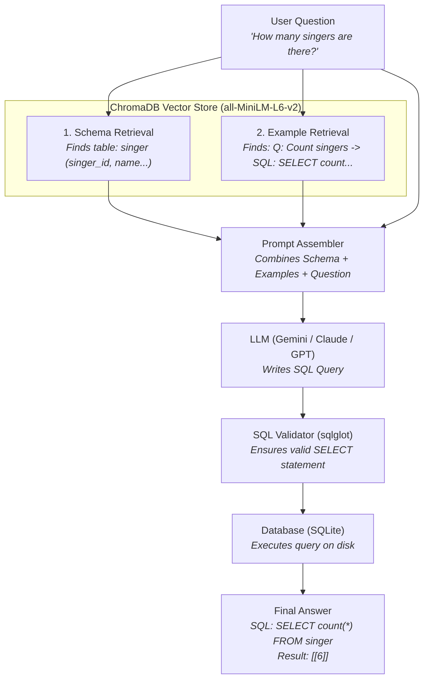

# 🚀 DataPilot AI (Text2SQL)

> **Turn plain English questions into accurate SQL queries and database answers using Dual RAG and AI.**

Ask a question like:
> *"How many singers are from the USA?"*

DataPilot AI will automatically:
1. 🔍 **Find the right tables & columns** in your database (Schema Retrieval).
2. 💡 **Find similar question-to-SQL examples** to guide the AI (Few-Shot Retrieval).
3. 🤖 **Write the SQL query** using an LLM (Google Gemini, OpenAI, or Claude).
4. 🛡️ **Check the query for errors** and safety (SQL Validator).
5. ⚡ **Run the query on the database** and return your real answer.

---

## 📑 Table of Contents
- [How It Works (Dual RAG)](#-how-it-works-dual-rag)
- [Pipeline Modes](#-pipeline-modes)
- [Quickstart Guide](#-quickstart-guide)
  - [1. Prerequisites](#1-prerequisites)
  - [2. Installation](#2-installation)
  - [3. Configure Environment (.env)](#3-configure-environment-env)
  - [4. Index the Database](#4-index-the-database)
  - [5. Start the Server](#5-start-the-server)
- [Testing the API](#-testing-the-api)
- [Running Experiments & Benchmarks](#-running-experiments--benchmarks)
- [Project Structure](#-project-structure)

---

## 🧠 How It Works (Dual RAG)

If you just give an LLM a question without context, it will hallucinate table names or make up columns that don't exist.

**Dual RAG** solves this by retrieving **two separate pieces of information** from a local vector database (ChromaDB) before calling the AI:



---

## 🎛️ Pipeline Modes

You can switch between three pipeline modes in your `.env` file depending on your needs:

| Mode | What it does | Speed | LLM Calls | Best For |
|---|---|:---:|:---:|---|
| **`baseline`** | Linear 1-shot pipeline: retrieves context, writes SQL once, validates, and runs. | ⚡ Fastest (~1.2s) | 1 call | Daily use, fast response, low token usage. |
| **`deterministic`** | **Self-healing pipeline:** Refines schema to 100% precision. If SQL has a syntax error, it automatically sends the error back to the LLM to fix it. | 🛡️ High Accuracy (~2.4s) | 2–3 calls | Complex databases where queries might need automatic repair. |
| **`agent`** | Autonomous ReAct agent: the LLM dynamically decides when to inspect schemas, test queries, and execute tools. | 🐢 Slower | 5–10 calls | Research, complex multi-hop investigation. |

---

## ⚡ Quickstart Guide

### 1. Prerequisites
- **Python 3.12** installed
- **`uv`** package manager installed ([Install uv](https://docs.astral.sh/uv/getting-started/installation/))

### 2. Installation
Clone the repository and install all dependencies:

```bash
# Clone the repository
git clone <your-repo-url>
cd "DataPilot AI"

# Install all dependencies with uv
uv sync --extra dev
```

### 3. Configure Environment (`.env`)
Create your `.env` file from `.env.example`:

```bash
cp .env.example .env
```

Open `.env` and configure your LLM and embeddings. For example, using **Google Gemini** + **Free Local Embeddings**:

```env
# LLM Settings (Google Gemini)
LLM_PROVIDER=gemini
LLM_MODEL=gemini-3.5-flash-lite
GEMINI_API_KEY=your-gemini-api-key-here

# Free, Fast Local Embeddings (Runs 100% on your machine)
EMBEDDING_PROVIDER=sentence-transformers
EMBEDDING_MODEL=all-MiniLM-L6-v2
HF_HUB_OFFLINE=1

# Storage & Pipeline Settings
CHROMA_PERSIST_DIR=.chroma
SPIDER_DATA_DIR=spider_data
PIPELINE_VARIANT=baseline
MAX_RETRIES=2
LOG_LEVEL=INFO
```

> 💡 **Tip:** You can also use `LLM_PROVIDER=anthropic` (`ANTHROPIC_API_KEY`) or `LLM_PROVIDER=openai` (`OPENAI_API_KEY`).

### 4. Index the Database
Place the [Spider benchmark dataset](https://yale-lily.github.io/spider) inside `spider_data/` and index all schemas and examples into ChromaDB (run once):

```bash
uv run python scripts/index_spider.py
```

*Output:*
```text
Loaded 876 schema documents -> Indexed into ChromaDB
Loaded 7000 training examples -> Indexed into ChromaDB
Indexing complete!
```

### 5. Start the Server
Run the FastAPI web backend:

```bash
uv run uvicorn app.main:app --reload
```

The server is now live at **`http://127.0.0.1:8000`**!

---

## 🧪 Testing the API

### Option A: Interactive Web UI (Swagger)
Open your browser and visit:
👉 **[http://127.0.0.1:8000/docs](http://127.0.0.1:8000/docs)**

1. Click on `POST /query` $\rightarrow$ **Try it out**
2. Paste the JSON below and click **Execute**:
```json
{
  "question": "How many singers are there?",
  "db_id": "concert_singer"
}
```

### Option B: PowerShell
```powershell
Invoke-RestMethod -Method Post -Uri "http://127.0.0.1:8000/query" -ContentType "application/json" -Body '{"question": "How many singers are there?", "db_id": "concert_singer"}'
```

### Option C: cURL
```bash
curl -X POST "http://127.0.0.1:8000/query" \
  -H "Content-Type: application/json" \
  -d '{"question": "How many singers are there?", "db_id": "concert_singer"}'
```

### Example JSON Response
```json
{
  "question": "How many singers are there?",
  "generated_sql": "SELECT count(*) FROM singer",
  "answer": "[[6]]",
  "retrieved_schema_summary": ["singer", "concert"],
  "execution_metadata": {
    "success": true,
    "row_count": 1,
    "latency_ms": 4.7
  },
  "flags": []
}
```

---

## 📊 Running Experiments & Benchmarks

You can evaluate how well the AI answers questions across the Spider benchmark:

```powershell
uv run python scripts/run_experiment.py --variants baseline deterministic --limit 10 --concurrency 1
```

> ⚠️ **Note for Free Tier Users:** Always keep `--concurrency 1` so you don't exceed your free API rate limits.

### Sample Benchmark Output:
```text
================================================================================
EXPERIMENT RESULTS
================================================================================
Variant         Exec Acc   Exact Match  Schema Recall  Latency(ms)  Retries
--------------------------------------------------------------------------------
baseline        1.000      0.600        1.000          7.9          N/A
deterministic   1.000      0.600        1.000          4.7          N/A
--------------------------------------------------------------------------------
Winner: baseline
================================================================================
```
* **Exec Acc (1.000):** 100% of generated queries returned the exact right database results.
* **Schema Recall (1.000):** ChromaDB found 100% of the needed tables.
* **Exact Match (0.600):** 60% of queries matched human-written gold SQL token-for-token.

---

## 📁 Project Structure

```text
DataPilot AI/
├── app/
│   ├── api/            # FastAPI routes (/health, /query) and request/response models
│   ├── core/           # Configuration (.env), logging, and LLM factory
│   ├── db/             # Database introspection, schema models, SQL validator & executor
│   ├── llm/            # System prompts, few-shot prompt assembly, and SQL generator
│   ├── pipeline/       # Pipeline engines: Baseline, Deterministic (LangGraph), ReAct Agent
│   ├── profiler/       # Optional PostgreSQL execution plan parser and transpiler
│   └── retrieval/      # ChromaDB vector retrieval for schemas and few-shot examples
├── docs/               # Detailed architecture, dataset guides, and technical design notes
├── scripts/
│   ├── index_spider.py     # Indexes schemas and training examples into ChromaDB
│   └── run_experiment.py   # Runs accuracy benchmarks against Spider dev set
├── tests/              # Comprehensive unit and integration test suite (pytest)
├── .env                # Your active API keys and configuration
├── pyproject.toml      # Python dependencies and tool configuration
└── README.md           # Project documentation
```

---

## 🛠️ Verification & Development Commands

```bash
# Run unit & integration tests
uv run pytest

# Check code formatting & linting
uv run ruff check .
uv run ruff format --check .

# Run static type checking
uv run mypy app
```

---

## 📜 License
This project is open-source under the MIT License.
