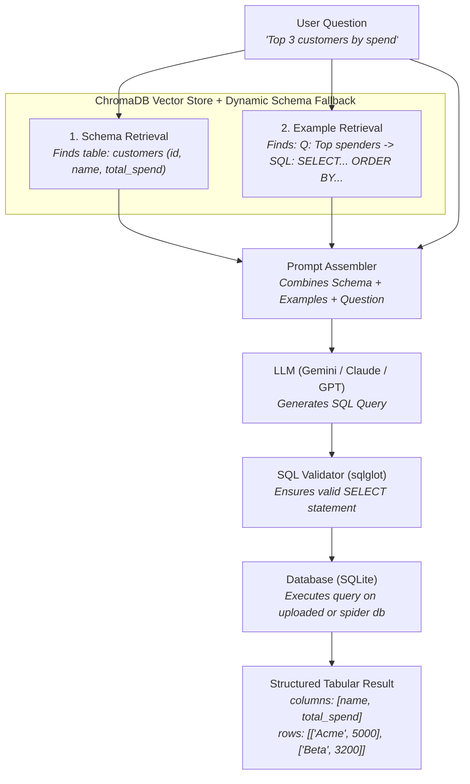

# 🚀 DataPilot AI (Text2SQL)

> **Turn plain English questions into accurate SQL queries and database answers using Dual RAG and AI — on pre-built databases or your own uploaded spreadsheets & tables.**

Ask a question like:
> *"Show the top 5 customers by revenue"* or *"How many singers are from the USA?"*

DataPilot AI will automatically:
1. 📁 **Ingest custom datasets** (CSV, TSV, multi-sheet Excel, JSON, Parquet, or SQLite).
2. 🔍 **Find the right tables & columns** in your database (Schema Retrieval).
3. 💡 **Find similar question-to-SQL examples** to guide the AI (Few-Shot Retrieval).
4. 🤖 **Write the SQL query** using an LLM (Google Gemini, Claude, or OpenAI).
5. 🛡️ **Check the query for errors** and safety (SQL Validator).
6. ⚡ **Run the query on the database** and return real, structured tabular results (`column_names` & `rows`).

---

## 📑 Table of Contents
- [✨ Key Features](#-key-features)
- [🧠 How It Works (Dual RAG)](#-how-it-works-dual-rag)
- [🎛️ Pipeline Modes](#-pipeline-modes)
- [⚡ Quickstart Guide](#-quickstart-guide)
  - [1. Backend Setup](#1-backend-setup)
  - [2. Configure Environment (.env)](#2-configure-environment-env)
  - [3. Start the Backend Server](#3-start-the-backend-server)
  - [4. Start the Frontend (Optional)](#4-start-the-frontend-optional)
- [🧪 API Reference & Testing](#-api-reference--testing)
  - [File Upload (`POST /upload`)](#1-file-upload-post-upload)
  - [Text2SQL Query (`POST /query`)](#2-text2sql-query-post-query)
  - [Database Explorer (`GET /databases`)](#3-database-explorer-get-databases)
  - [Table Data Preview (`GET /databases/{db_id}/tables/{table_name}/data`)](#4-table-data-preview)
- [📊 Running Experiments & Benchmarks](#-running-experiments--benchmarks)
- [📁 Project Structure](#-project-structure)
- [🛠️ Verification & Development Commands](#️-verification--development-commands)

---

## ✨ Key Features

- 📤 **Upload Table Files Directly**: Upload `.csv`, `.tsv`, `.xlsx`, `.xls`, `.json`, `.parquet`, or `.sqlite` files. Data is automatically parsed, typed, sanitized, and stored as SQLite tables.
- 📊 **Multi-Sheet Excel Support**: Uploading an Excel workbook automatically converts each sheet into its own relational table.
- ⚡ **Structured Table Outputs**: Returns both raw SQL and structured `column_names` and `rows` arrays ready to display in frontend datatables.
- 🔄 **Self-Healing SQL**: Self-corrects syntax and runtime errors automatically when running under the `deterministic` pipeline mode.
- 🎨 **Modern React Frontend**: Initialized with Vite, TypeScript, Tailwind CSS v4, shadcn UI, and React Bits animations.
- 🔌 **CORS Enabled**: Out-of-the-box cross-origin support for seamless local and remote frontend integration.

---

## 🧠 How It Works (Dual RAG)

If you give an LLM a question without context, it will hallucinate table names or invent columns that don't exist.

**Dual RAG** solves this by retrieving **two separate pieces of information** before calling the AI:



---

## 🎛️ Pipeline Modes

You can switch between three pipeline modes in your `.env` file depending on your needs:

| Mode | What it does | Speed | LLM Calls | Best For |
|---|---|:---:|:---:|---|
| **`baseline`** | Linear 1-shot pipeline: retrieves context, writes SQL once, validates, and runs. | ⚡ Fastest (~1.2s) | 1 call | Daily use, fast response, low token usage. |
| **`deterministic`** | **Self-healing pipeline (LangGraph):** Refines schema to 100% precision. If SQL has a syntax error, it automatically critiques and fixes it. | 🛡️ High Accuracy (~2.4s) | 2–3 calls | Complex databases where queries might need automatic repair. |
| **`agent`** | Autonomous ReAct agent: the LLM dynamically decides when to inspect schemas, test queries, and execute tools. | 🐢 Slower | 5–10 calls | Research, complex multi-hop investigation. |

---

## ⚡ Quickstart Guide

### 1. Backend Setup
- **Python 3.12** installed
- **`uv`** package manager installed ([Install uv](https://docs.astral.sh/uv/getting-started/installation/))

```bash
# Clone the repository
git clone <your-repo-url>
cd "DataPilot AI"

# Install all dependencies with uv
uv sync --extra dev
```

### 2. Configure Environment (`.env`)
Create your `.env` file from `.env.example`:

```bash
cp .env.example .env
```

Configure your LLM settings in `.env`:
```env
# LLM Provider (gemini, anthropic, or openai)
LLM_PROVIDER=gemini
LLM_MODEL=gemini-3.5-flash-lite
GEMINI_API_KEY=your-api-key-here

# Local Embeddings (Free, runs on CPU)
EMBEDDING_PROVIDER=sentence-transformers
EMBEDDING_MODEL=all-MiniLM-L6-v2

# Storage & Pipeline Settings
CHROMA_PERSIST_DIR=.chroma
SPIDER_DATA_DIR=spider_data
UPLOAD_DIR=uploads
PIPELINE_VARIANT=baseline
```

### 3. Start the Backend Server

```bash
uv run uvicorn app.main:app --reload
```
The API is now live at **`http://127.0.0.1:8000`** (Swagger docs at `http://127.0.0.1:8000/docs`).

### 4. Start the Frontend

```bash
cd frontend
npm install
npm run dev
```
The Next.js 16 application will be live at **`http://localhost:3000`**.

---

## 🧪 API Reference & Testing

### 1. Direct SQL Execution (`POST /execute`)
Execute any user-authored or edited read-only SQL query directly against the target database:

```bash
curl -X POST "http://127.0.0.1:8000/execute" \
  -H "Content-Type: application/json" \
  -d '{"sql": "SELECT name, salary FROM staff ORDER BY salary DESC LIMIT 5", "db_id": "company_db"}'
```

**Response:**
```json
{
  "success": true,
  "sql": "SELECT name, salary FROM staff ORDER BY salary DESC LIMIT 5",
  "column_names": ["name", "salary"],
  "rows": [["Alice", 95000], ["Bob", 82000]],
  "row_count": 2,
  "latency_ms": 1.45,
  "error": null
}
```

### 2. File Upload (`POST /upload`)
Upload a table file to create a queryable database:

```bash
curl -X POST "http://127.0.0.1:8000/upload" \
  -F "file=@employees.csv" \
  -F "db_id=company_db" \
  -F "table_name=staff"
```

**Response:**
```json
{
  "success": true,
  "message": "Successfully ingested 1 table(s) into database 'company_db'.",
  "db_id": "company_db",
  "tables": [
    {
      "name": "staff",
      "row_count": 50,
      "columns": [
        {"name": "id", "data_type": "BIGINT", "is_primary_key": false},
        {"name": "name", "data_type": "TEXT", "is_primary_key": false},
        {"name": "salary", "data_type": "FLOAT", "is_primary_key": false}
      ],
      "sample_rows": [
        {"id": 1, "name": "Alice", "salary": 75000}
      ]
    }
  ]
}
```

### 2. Text2SQL Query (`POST /query`)
Ask a plain-English question on your uploaded database (or any Spider database):

```bash
curl -X POST "http://127.0.0.1:8000/query" \
  -H "Content-Type: application/json" \
  -d '{"question": "What is the average salary in staff?", "db_id": "company_db"}'
```

**Response:**
```json
{
  "question": "What is the average salary in staff?",
  "generated_sql": "SELECT AVG(salary) FROM staff",
  "answer": "[[78500.0]]",
  "column_names": ["AVG(salary)"],
  "rows": [[78500.0]],
  "retrieved_schema_summary": ["staff"],
  "execution_metadata": {
    "success": true,
    "row_count": 1,
    "latency_ms": 3.8
  }
}
```

### 3. Database Explorer (`GET /databases`)
List all uploaded and pre-indexed databases:

```bash
curl -X GET "http://127.0.0.1:8000/databases"
```

### 4. Table Data Preview
Retrieve paginated rows directly for any table:

```bash
curl -X GET "http://127.0.0.1:8000/databases/company_db/tables/staff/data?limit=25&offset=0"
```

---

## 📊 Running Experiments & Benchmarks

Evaluate Text2SQL accuracy on the Spider benchmark dataset:

```powershell
uv run python scripts/run_experiment.py --variants baseline deterministic --limit 10 --concurrency 1
```

---

## 📁 Project Structure

```text
DataPilot AI/
├── app/
│   ├── api/            # FastAPI routes (/health, /query, /upload, /databases) & Pydantic models
│   ├── core/           # Configuration (AppSettings), logging, and LLM provider factory
│   ├── db/             # File ingestion (ingest.py), storage manager (storage.py), validator & executor
│   ├── llm/            # System prompts, prompt assembler, and SQL generator
│   ├── pipeline/       # Pipeline variants: Baseline, Deterministic (LangGraph), ReAct Agent
│   ├── profiler/       # Optional PostgreSQL execution plan parser and transpiler
│   └── retrieval/      # ChromaDB vector retrieval with direct-table & semantic fallbacks
├── frontend/           # Next.js 16 + React 19 + TypeScript + Tailwind CSS v4 + shadcn UI
│   ├── app/            # App Router (page.tsx, layout.tsx, globals.css)
│   ├── components/     # UI components (buttons, icons, docks)
│   └── components.json # shadcn configuration
├── docs/               # Architecture and dataset documentation
├── scripts/            # Database indexing and benchmark runners
├── tests/              # Test suite (unit and integration tests)
├── .env.example        # Environment variable template
├── pyproject.toml      # Python dependencies and build settings
└── README.md           # Documentation
```

---

## 🛠️ Verification & Development Commands

```bash
# Run unit & integration tests
uv run pytest

# Check code formatting & linting
uv run ruff check .

# Auto-fix linting issues
uv run ruff check --fix .

# Run static type checking
uv run mypy app
```

---

## 📜 License
This project is open-source under the MIT License.
